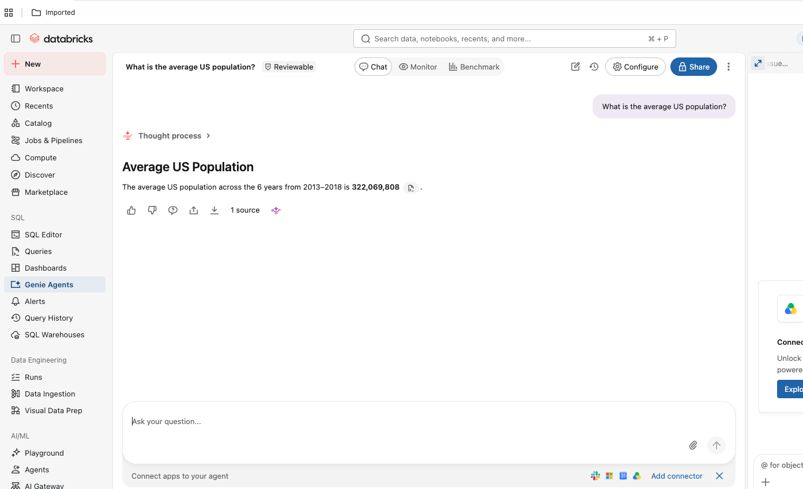
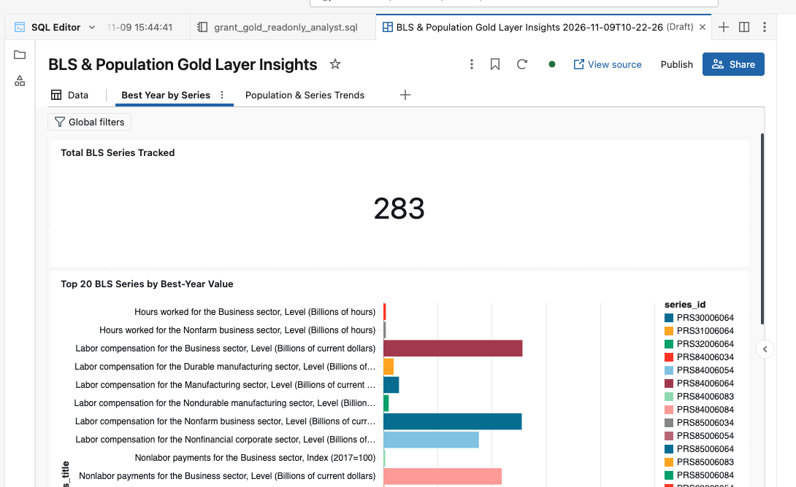
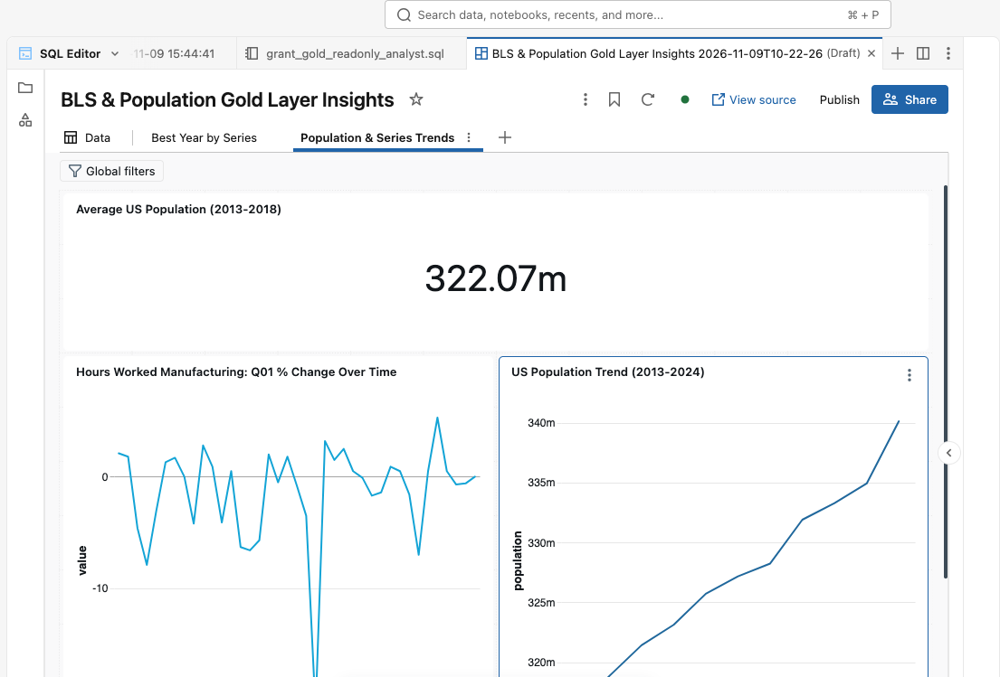
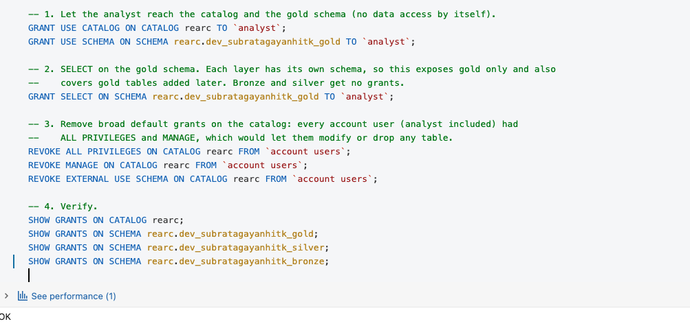
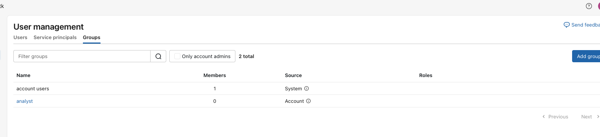

# PROCESS

## Architecture

**One schema per layer.** Each medallion layer has its own Unity Catalog schema. The bundle declares
them, and in dev mode it prefixes the names, e.g. `rearc.dev_subratagayanhitk_bronze`.

| Schema | Contains |
|---|---|
| `bronze` | the `raw` Volume, `active_files`, `bronze_bls_data`, `bronze_bls_series`, `bronze_population` |
| `silver` | `silver_bls_observations`, `silver_bls_series`, `silver_population` |
| `gold` | `gold_population_stats` (Q1), `gold_best_year_by_series` (Q2), `gold_series_population` (Q3) |

- One pipeline publishes to all three schemas. Bronze is its default schema.
- Silver and gold datasets use fully qualified names, built from the `silver_schema` and
  `gold_schema` pipeline configuration values. The same code therefore deploys to any catalog or
  target.
- The split makes access control simple: an analyst gets `SELECT` on the gold schema and nothing
  else (see Bonus).
- It also keeps each layer's purpose and lifecycle visible in the catalog.

**Ingestion (`src/ingest.py`).** A standalone script lands raw files in the `raw` Volume, in the
bronze schema:

```
bls/pr/<file>/<version>/<file>                  immutable versions of each BLS file
datausa/population/<version>/population.json    immutable versions of the DataUSA API response
_state/active_files.json                        which version of each file is live
```

- The BLS directory listing is parsed on every run, so no filenames are hardcoded.
- The population data is fetched live from the DataUSA Tesseract API on every run.
- BLS requests send a `User-Agent` with a contact email, because BLS returns 403 to anonymous robots
  (https://www.bls.gov/bls/pss.htm). Requests are spaced out, and 429/5xx responses back off using
  `Retry-After`.

**Re-running ingestion safely.**
- Unchanged files are skipped. BLS files are compared on listed timestamp and size, the DataUSA
  response on a content hash.
- New or changed files are written to a new `<version>/` directory. Nothing is overwritten.
- Files removed upstream are dropped from `active_files.json`.
- Downloads go to a temp file and are then moved into place, so a half-written file never lands.
- The state file is written last, so a failed run is simply redone on the next run.
- An empty or unparseable listing aborts the run instead of being treated as "every file deleted".

**Why versioned paths.** Auto Loader tracks files by path. A file overwritten at the same path is
either missed (the default) or re-read with no way to tell old rows from new. A new path per version
fixes this: each version is ingested exactly once, and `active_files.json` says which one is current.

**Bronze (PySpark, streaming tables + Auto Loader).** Bronze keeps values exactly as published, as
strings, and records the source path and version on each row. Refresh cost scales with what changed.
Schema checks happen on the way in:
- A BLS header that doesn't match the documented columns fails the update. Mis-parsing positional
  data silently would be worse.
- Rows with the wrong field count or a null key are dropped.
- The DataUSA JSON is read with an explicit schema.

Data files are matched by `*.data.*`, so a new BLS data partition is picked up without code changes.

**Silver (PySpark, `AUTO CDC FROM SNAPSHOT` into streaming tables).**
- BLS and DataUSA publish full snapshots, not change events. For each silver table, a temporary
  `*_snapshot` view builds the current snapshot:
  - it joins bronze to `active_files`, so only the live file versions are used,
  - it trims the space-padded fields and casts types,
  - it de-duplicates to one row per key, because `pr.data.0.Current` and `pr.data.1.AllData` overlap,
  - it validates year, period, value and population with expectations.
- `value` is `DECIMAL(18,3)`, so sums are exact.
- `create_auto_cdc_from_snapshot_flow` (SCD type 1) diffs each snapshot against the previous one and
  applies only the changes:
  - a new key is **inserted**,
  - a key whose values changed is **updated**,
  - a key that disappeared is **deleted**, whether one row was removed or a whole file was deleted
    upstream.
- Unchanged rows are never rewritten. Replaced versions stay in bronze for audit.
- Keys: `(series_id, year, period)` for observations, `series_id` for series, `(nation_id, year)` for
  population.

**Streaming tables vs. materialized views.** A pipeline manages three dataset types. Streaming tables
and materialized views are both ordinary UC Delta tables that consumers query with plain SQL, and only
the pipeline writes to them. The difference is how they're written: a streaming table is filled by a
flow (Auto Loader, `AUTO CDC`), while a materialized view stores a query's result and is refreshed when
the query or its sources change (NO_OP, incremental or full). "Streaming" describes the write path, not
a job that's always running. Temporary views are stored nowhere; the pipeline uses them for the
silver snapshots.

```
[bronze schema]
Volume raw: one folder per file version
  bls/pr/*.data.*/<ver>/      ── Auto Loader ──▶  bronze_bls_data     (streaming table)
  bls/pr/*.series/<ver>/      ── Auto Loader ──▶  bronze_bls_series   (streaming table)
  datausa/population/<ver>/   ── Auto Loader ──▶  bronze_population   (streaming table)
  _state/active_files.json    ── full read   ──▶  active_files        (materialized view)
        │
        │  join bronze to active_files (live versions only), cast types, one row per key
        ▼
  *_snapshot                                                          (temporary views)
        │
        │  AUTO CDC FROM SNAPSHOT: insert / update / delete only what changed
        ▼
[silver schema]
  silver_bls_observations, silver_bls_series, silver_population      (streaming tables, SCD 1)
        │
        │  Enzyme refresh: NO_OP / incremental / full recompute
        ▼
[gold schema]
  gold_population_stats (Q1)
  gold_best_year_by_series (Q2)                                       (materialized views)
  gold_series_population (Q3)
```

- **Bronze: streaming tables (Auto Loader).** The raw files are immutable and append-only, which is
  what Auto Loader is built for. Each file version is read once and never re-scanned.
- **`active_files`: materialized view.** It is one small state file that ingestion rewrites at the
  same path. A streaming read would miss that rewrite, so it is re-read on every refresh.
- **Silver: streaming tables written by `AUTO CDC FROM SNAPSHOT`.**
  - Silver must retract rows when a file version is replaced or deleted upstream.
  - A streaming table written by a plain append flow can't retract rows.
  - A materialized view over a snapshot, which has no row lineage, tends to recompute everything.
  - In a pipeline, only a streaming table can be the target of an `AUTO CDC` flow. That flow writes
    just the inserts, updates and deletes, as a `MERGE`, and gold can refresh from those row-level
    changes.
- **Gold: materialized views.** Gold is small derived answers: aggregates, a window and a join over
  silver. A materialized view always returns the same result as the equivalent batch query, and
  serverless refreshes it incrementally where it can. Gold doesn't join `active_files`, because silver
  already contains only the active versions.

**How the silver diff works.** On every update, `AUTO CDC FROM SNAPSHOT` reads the whole
`*_snapshot` view and compares it with the target, key by key:
- a new key is inserted,
- a key with any changed non-key column is updated,
- a key that disappeared is deleted,
- an identical row is not written.

So the read is a full scan of the active data (about 92k rows), while the write is proportional to
what changed. `version` is not a silver column, so re-ingesting identical content writes nothing.

**Why not CDF-based `AUTO CDC`.** Bronze is append-only, loaded from files:
- A republished file arrives as a new set of inserts, not as updates.
- A file deleted upstream produces no event at all.
- Which version is live is recorded in `active_files.json`, not in bronze's change feed.

The source publishes snapshots, so a snapshot diff is the correct way to derive changes.

**How gold knows what changed.** Silver has row tracking and deletion vectors enabled. On each
refresh, Enzyme reads silver's row-level changes since gold's last refresh. It then chooses
`NO_OP`, an incremental technique, or `COMPLETE_RECOMPUTE`, based on the query shape and cost. If
silver were a materialized view, it would mostly recompute in full, for three reasons:
- it joins on a moving `active_files` set,
- it de-duplicates across files,
- it must delete rows.

Every refresh would then rewrite all of silver and push gold into full recomputes as well.

**Gold guard.** `gold_population_stats` has `EXPECT (years = 6) ON VIOLATION FAIL UPDATE`. If a year
goes missing upstream, the refresh fails and the previous correct result stays. Otherwise the query
would quietly publish a plausible stddev over five years.

**Verified on the workspace** (rebuilt from scratch into the bronze/silver/gold schemas, 2026-11-09
data):

| Table | Rows |
|---|---|
| `bronze_bls_data` | 138,489 |
| `silver_bls_observations` | 92,328 (no duplicate keys) |
| `silver_bls_series` | 337 |
| `silver_population` | 11 |
| `gold_best_year_by_series` | 283 |
| `gold_series_population` | 39 |
| `gold_population_stats` | 6 years |

- **First run:** silver's `MERGE` inserted 92,328 rows.
- **Second run, with no upstream change:** silver's `MERGE` read 0 source rows and inserted, updated
  and deleted 0 rows. All three gold tables were planned as `NO_OP`.

**Workspace screenshots.** Pipeline run in the bronze/silver/gold schemas: bronze → `*_snapshot`
views → silver → gold, all flows completed and all expectations met. The table list counts 13: the 10 tables plus the 3 temporary snapshot views.


The pipeline succeeded. The job's red run is the `ingest` task: Free Edition blocks outbound access to
bls.gov, so I ran ingestion locally and uploaded the files.


Catalog view: `dev_subratagayanhitk_bronze` holds 4 tables and the `raw` Volume, `_silver` holds 3
tables, and `_gold` holds 3 tables.


Q1: `gold_population_stats`


Q2: `gold_best_year_by_series` (283 series)


Q3: `gold_series_population` (39 rows; population is null for years outside ACS 1-year coverage)


**Gold: SQL vs. PySpark.**
- **Q1 and Q3: SQL is primary.** Each is a filter plus an aggregate or a join, which reads most
  clearly as SQL.
- **Q2: PySpark is primary.** "Top-1 per group" is a window over an aggregate, which is easier to
  compose and comment step by step in PySpark.
- Each question also has an alternative in the other language (`alternatives.py`,
  `alternatives.sql`). These are documentation only and not deployed. I checked locally that each pair
  returns identical rows.

## Trade-offs

What I'd do differently for a real client:
- **Data volume.** Silver writes only the changes, but it still reads the active snapshot on every
  update to compute the diff. At larger scale I'd switch to historical snapshots keyed on the ingest
  version: the source function returns a new snapshot only when the ingest version changes, so a run
  with no upstream change skips the read and the diff entirely. I'd also expire old raw versions
  with a retention job.
- **Schema drift.** Today any drift fails fast. I'd add a rescued-data column plus alerts, so additive
  changes don't block the pipeline.
- **Access control.** The analyst already has read access to the gold schema only (see Bonus). For a
  client I'd also manage the grants in the bundle instead of a SQL script, and run jobs as a service
  principal.
- **Monitoring.** Alert on expectation metrics from the pipeline event log, send job failure
  notifications, and add a freshness check against the BLS release calendar.
- **Cost.** Run serverless on a daily or release-aligned schedule. A run with no upstream changes
  downloads nothing and ingests nothing.
- **Egress.** Free Edition blocks outbound access to `download.bls.gov`, so I ran ingestion locally
  and uploaded the files. On a paid workspace the bundled job runs end to end.

## AI usage

I used Devin (an AI coding assistant) to:
- scaffold the bundle, ingestion script and pipeline files,
- look up current Databricks APIs (the `pyspark.pipelines` module, DAB resource fields, Auto Loader
  options),
- write a throwaway local PySpark harness that ran the pipeline code against the real downloaded data.

How I validated and corrected its output:
- **I steered the design through three rounds.**
  1. The first draft was over-engineered.
  2. The simpler second draft re-read every file on each refresh.
  3. The final design uses streaming bronze over immutable file versions.
- **I rejected full recompute in silver.** An earlier version made silver materialized views and
  argued that recomputing them was cheap. I changed silver to `AUTO CDC FROM SNAPSHOT`, so it applies
  only inserts, updates and deletes, and kept materialized views for gold.
- **I tested change handling.** I simulated an upstream change to `pr.series`. Bronze held both
  versions and silver showed only the active one.
- **I fixed portability issues.** `QUALIFY` failed on open-source Spark, so I rewrote it as a
  `row_number()` subquery.
- **I checked the data semantics against the sources.** The Q05 annual average and the overlapping data
  files came from reading `pr.txt` and the raw files, not from the AI's assumptions.
- **I verified the answers by hand.** For example, I computed the Q1 mean from the six population
  values, and the workspace results match the local run.
- **I checked incrementality on the workspace rather than trusting the docs.** I used the Delta
  history (`MERGE` metrics) and the event log (`planning_information`).
- **I audited the access grants.** My first version granted `SELECT` on the whole schema. A review
  with the assistant pointed out two problems: that grant also exposed bronze, silver and
  `active_files`, and `account users` held `ALL PRIVILEGES` on the catalog. I revoked the catalog
  grant, then split the layers into separate schemas, so read access to gold can be granted at the
  schema level. I checked the result with `SHOW GRANTS`.

## Retrospective

The data semantics were harder to get right than the code:
- an annual-average period mixed in with the quarters,
- two overlapping data files,
- space-padded fields and CRLF line endings,
- a deprecated DataUSA endpoint.

The other hard part was making re-runs correct when files change or disappear upstream, given how
Auto Loader tracks files. That led to the versioned-path design.

## Bonus

### Genie space and dashboard on the gold layer

**Genie space.** A non-technical user asks questions in plain English, and Genie answers from the gold
tables. Asked "What is the average US population?", it returns 322,069,808, which matches Q1.



**Dashboard: "BLS & Population Gold Layer Insights".** It has two pages, both built only on gold
tables.

The first page, *Best Year by Series*, shows the 283 series tracked and the top 20 series by
best-year value, labelled with `series_title`.



The second page, *Population & Series Trends*, shows:
- the 2013–2018 average population (322.07M, Q1),
- the Q01 trend for `PRS30006032` (Q3),
- the US population trend.



### Unity Catalog access for a read-only analyst

The `analyst` principal can read the gold layer and nothing else. The grants are in
`sql/grant_gold_readonly_analyst.sql`:

| Object | `analyst` gets | Why |
|---|---|---|
| Catalog `rearc` | `USE CATALOG` | needed to reach the schema; gives no data access |
| Schema `dev_..._gold` | `USE SCHEMA`, `SELECT` | reads all gold tables, including gold tables added later |
| Schemas `dev_..._silver`, `dev_..._bronze` (including the `raw` Volume) | nothing | |

The grants as run in the SQL editor:



`analyst` is an account-level group. Analysts get access by being added to it, and the grants never
name individual users.



### Deployed with Databricks Asset Bundles

Nothing was created by clicking through the UI. `databricks.yml` declares every resource:
- the `bronze`, `silver` and `gold` schemas,
- the managed `raw` Volume, in bronze,
- the serverless pipeline, with its source files and configuration (`raw_root`, `silver_schema`,
  `gold_schema`),
- the job, with an `ingest` task followed by a `refresh_pipeline` task.

The catalog and contact email are passed as bundle variables. The `dev` target runs in development
mode, so:
- resource names get a `[dev subratagayanhitk]` prefix,
- the schemas become `dev_subratagayanhitk_bronze`, `_silver` and `_gold`.

The commands I ran:

```bash
databricks bundle validate --var catalog=rearc --var contact_email=...
databricks bundle deploy   --var catalog=rearc --var contact_email=...
databricks bundle run rearc_quest_pipeline --var catalog=rearc --var contact_email=...
```

The split into layer schemas was itself a bundle change. `bundle plan` showed the diff, and
`bundle deploy` applied it from code:

```
$ databricks bundle plan ...
update jobs.rearc_quest_job
update pipelines.rearc_quest_pipeline
create schemas.bronze
create schemas.gold
delete schemas.rearc_quest
create schemas.silver
recreate volumes.raw
Plan: 4 to add, 2 to change, 2 to delete, 0 unchanged

$ databricks bundle deploy --auto-approve ...
Deleted schemas.rearc_quest
Created schemas.bronze
Created schemas.silver
Created schemas.gold
Recreated volumes.raw
Updated pipelines.rearc_quest_pipeline
Updated jobs.rearc_quest_job
Resources: 4 created, 2 changed, 2 deleted, 0 unchanged
```

`bundle validate` and `bundle summary` show the deployed resources:

```
Name: rearc_quest
Target: dev
Workspace:
  User: subratagayanhitk@gmail.com
  Path: /Workspace/Users/subratagayanhitk@gmail.com/.bundle/rearc_quest/dev
Validation OK!

Resources:
  Jobs:      rearc_quest_job      -> [dev subratagayanhitk] rearc_quest_job
  Pipelines: rearc_quest_pipeline -> [dev subratagayanhitk] rearc_quest_pipeline
  Schemas:   bronze               -> dev_subratagayanhitk_bronze
             silver               -> dev_subratagayanhitk_silver
             gold                 -> dev_subratagayanhitk_gold
  Volumes:   raw                  -> raw (in dev_subratagayanhitk_bronze)
```

A prod deployment would add a `prod` target with its own catalog and a service principal as
`run_as`. The code would not change.
