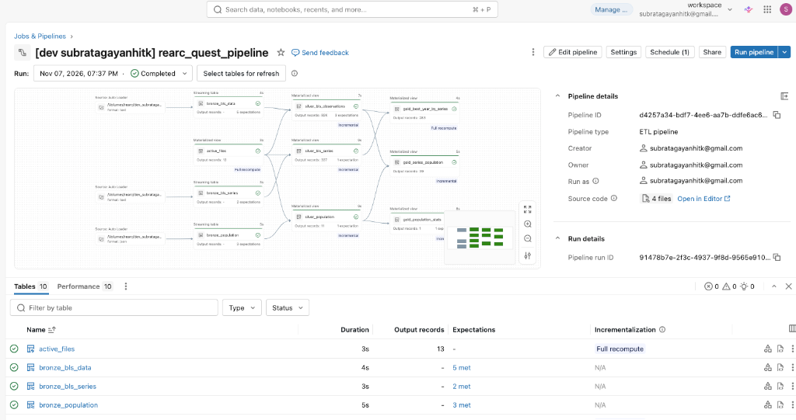
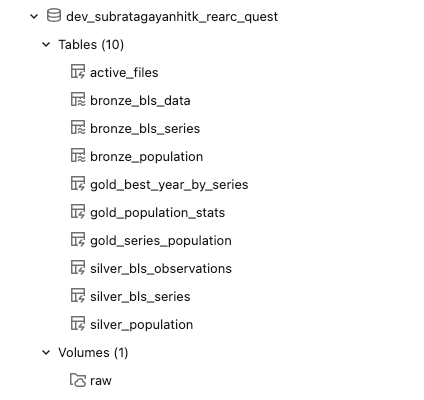
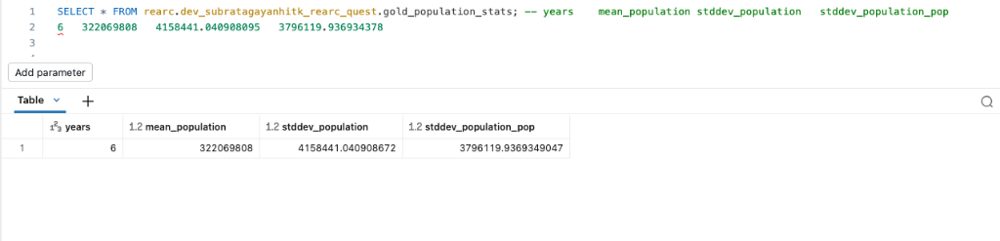
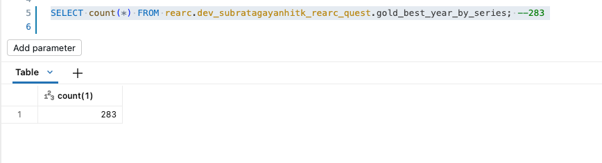
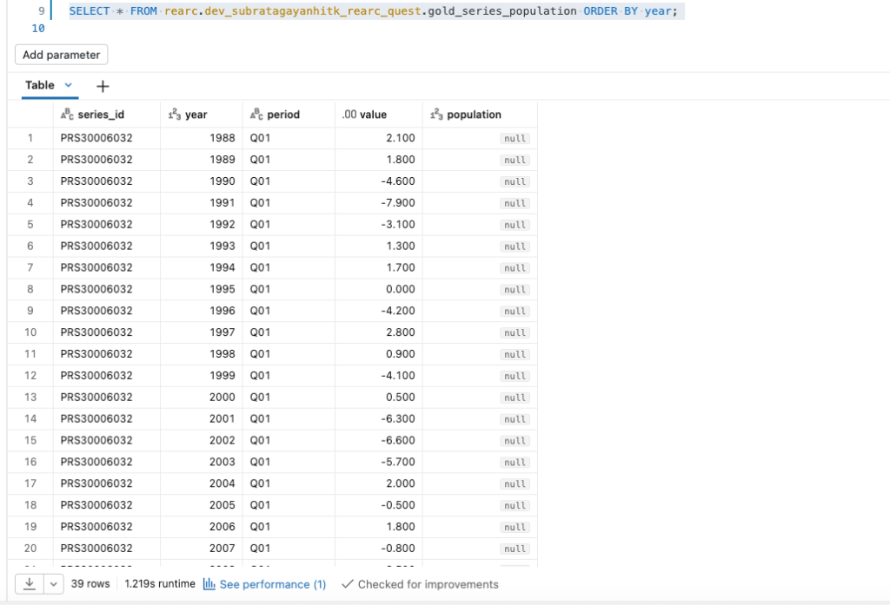

# rearc

Rearc data quest: BLS Productivity & Costs (`pr`) + DataUSA population, ingested into a Unity Catalog
Volume and modelled as a Spark Declarative Pipeline (bronze → silver → gold), deployed with a Databricks
Asset Bundle.

```
databricks.yml              schema, volume, pipeline and job
src/ingest.py               Step 1: BLS directory sync + DataUSA fetch into the Volume
src/pipeline/bronze.py      Auto Loader streaming tables (schema + non-null key expectations)
src/pipeline/silver.sql     active file versions only; trimmed, typed, de-duplicated
src/pipeline/gold.sql       Q1, Q3 (primary, Spark SQL)
src/pipeline/gold.py        Q2 (primary, PySpark)
src/pipeline/alternatives.* Q1/Q3 in PySpark, Q2 in Spark SQL (documented, not run by the pipeline)
```

## Deploy and run

```bash
databricks auth login --host https://<your-workspace>.cloud.databricks.com
databricks bundle deploy --var contact_email=you@example.com
databricks bundle run rearc_quest_job --var contact_email=you@example.com
```

Free Edition: the default catalog is `workspace`, so add `--var catalog=workspace`. Free Edition also
restricts outbound internet. If the `ingest` task can't reach bls.gov, run the ingestion locally and
upload the files, then refresh the pipeline:

```bash
python src/ingest.py --target ./raw --contact-email you@example.com
databricks fs cp -r --overwrite ./raw dbfs:/Volumes/<catalog>/<schema>/raw
databricks bundle run rearc_quest_pipeline
```

## Answers (from a local run on 2026-11-07 data)

| Question | Table | Result |
|---|---|---|
| Q1 mean / stddev of US population 2013–2018 | `gold_population_stats` | mean 322,069,808; sample stddev 4,158,441.04 (population stddev 3,796,119.94) |
| Q2 best year per series | `gold_best_year_by_series` | 283 series, e.g. PRS30006011 → 2022 (16.4) |
| Q3 PRS30006032 Q01 + population | `gold_series_population` | 39 years, population where ACS has it |

## Workspace screenshots (Free Edition, dev target)

Pipeline run: bronze → silver → gold, all flows completed, expectations met.



The pipeline succeeded. The job's red run is the `ingest` task, which failed because Free Edition blocks
outbound access to bls.gov. Ingestion was run locally instead (see above).


Resulting schema: 10 pipeline tables and the `raw` Volume.



Q1: `gold_population_stats`



Q2: `gold_best_year_by_series` (283 series)



Q3: `gold_series_population` (39 rows; population is null outside ACS 1-year coverage)


